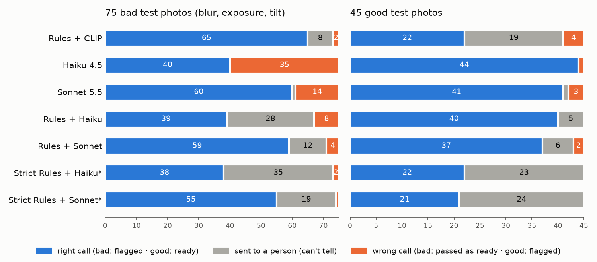

# hotel-photo-checks

**Checking hotel listing photos before they go live: cheap image rules vs a vision LLM vs both, with "can't tell" as
an allowed answer.** 160 openly licensed photos (40 real photos plus 120 copies edited to add a known defect), four
made-up hotels with fact sheets, and every checker scored on the same 120 test photos.



## The problem

A hotel's listing photos sell the room before any text is read. Photos get uploaded blurry, too dark, blown out or
crooked, the same shot gets uploaded twice, and sometimes a photo shows something the hotel doesn't have (a pool
photo from a hotel whose fact sheet says "no pool"). That last one becomes a complaint or a refund at check-in.

Checking by eye doesn't scale across hundreds of photos, and an automated checker brings two dangers of its own:

- **a wrong "ok"** puts a bad photo on the listing, and **a wrong "yes, it shows a pool"** makes the hotel promise
  something;
- a checker that **turns "I couldn't judge this" into a pass**, or reads a blank field on the fact sheet as "yes",
  looks perfect on exactly the photos nobody checked.

So every check here can answer **ok, problem, or unknown**. Each photo ends as **ready**, **fix** (a problem was
found), **person** (nothing wrong found, but something couldn't be judged) or **unreadable**. These are counted
separately and never folded into one score.

## Approach

```
photo ──▶ gate: exists? non-empty? decodes as JPEG, PNG or WebP only? at least 200 px?
            │ (CMYK, 16-bit, alpha, EXIF rotation handled)
            │ no → "unreadable" + reason, no model is called
            ▼
     ┌──────────────── rules (free, 0.04 s) ────────────────┐   ┌──── vision LLM (Claude via CLI) ────┐
     │ blur: variance of the Laplacian                      │   │ one call per photo, JSON only:       │
     │ exposure: mean brightness, share of blown pixels     │   │ blur / exposure / framing            │
     │ tilt: median slant of near-vertical Hough lines      │   │ + 5 amenities: yes / no / cant_tell  │
     │ amenities: CLIP ViT-B-32 zero-shot (10 prompts)      │   │ (never sees the fact sheet)          │
     │ thresholds tuned on the dev hotel only, ±25% = unknown│   └──────────────────────────────────────┘
     └──────────────────────────────────────────────────────┘                     │
                         └────────────── merge ──────────────────────────────────┘
                both agree → that answer · one can't tell → the other's · disagree → unknown
                                         ▼
     amenity seen × fact sheet: shown + "no" = contradiction · shown + blank = unverifiable · not seen = no claim
     duplicates: pHash distance between every pair in the batch (≤6 bits duplicate, 7-10 possible)
```

- **Photos.** 40 photos from Wikimedia Commons under CC0, public domain, CC BY or CC BY-SA (pools, gyms, bathrooms,
  bedrooms, fireplaces, dining rooms, sea views). None is of a hotel, and photos whose title names a business were
  dropped. Author, licence and source for each: [data/photos/LICENSES.csv](data/photos/LICENSES.csv).
- **Known defects.** Each photo gets three edited copies ([dataset.py](src/photo_checks/dataset.py)), so 20 of each:
  Gaussian blur, motion blur, under-exposure, over-exposure (both in linear light), a 5-10° rotation cropped so no
  empty corners give it away, and a near-duplicate (trimmed 3%, 5% brighter, re-saved as a low-quality JPEG). The
  severities are seeded and saved with each label.
- **Amenity labels by hand** ([data/amenities.yaml](data/amenities.yaml)): which of pool, gym, bathtub, sea view and
  fireplace each photo shows. Edited copies keep their source's labels.
- **Four made-up hotels** ([data/hotels.yaml](data/hotels.yaml)), each sending 40 photos (10 sources plus their
  copies) with a fact sheet that says yes, no or nothing for each amenity. One hotel (Saltmarrow House) is the
  **tuning set**; every number below comes from the other three (120 photos).
- **Checkers:** rules + CLIP; Claude Haiku 4.5; Claude Sonnet 5.5 (low effort); each LLM merged with the rules. A
  stricter merge (only agreed answers count) was added **after** the first test run and is marked * as post hoc.
- **Gate written first.** [evals/gate.yaml](evals/gate.yaml) was committed before any test result existed. One of
  its five rules failed, and it stays in the file: see [evals/known_failures.yaml](evals/known_failures.yaml).

## Results

<!-- results:start -->
Test set: 120 photos from the three test hotels (75 with a blur, exposure or tilt defect, 45 without; the 15 near-duplicates count as good here and are scored in the duplicate table).

**What happens to each photo** (ready = every check ok; person = nothing wrong found but something couldn't be judged)

| Checker | Bad photos passed as ready | Bad sent to a person | Bad flagged | Good ready | Good sent to a person | Good flagged | Cost per photo | Seconds per photo |
|---|---|---|---|---|---|---|---|---|
| Rules + CLIP | 2/75 | 8 | 65 | 22/45 | 19 | 4 | $0.0000 | 0.04 |
| Haiku 4.5 | 35/75 | 0 | 40 | 44/45 | 0 | 1 | $0.0047 | 7.07 |
| Sonnet 5.5 | 14/75 | 1 | 60 | 41/45 | 1 | 3 | $0.0063 | 2.7 |
| Rules + Haiku | 8/75 | 28 | 39 | 40/45 | 5 | 0 | $0.0047 | 7.1 |
| Rules + Sonnet | 4/75 | 12 | 59 | 37/45 | 6 | 2 | $0.0063 | 2.7 |
| Strict Rules + Haiku* | 2/75 | 35 | 38 | 22/45 | 23 | 0 | $0.0047 | 7.1 |
| Strict Rules + Sonnet* | 1/75 | 19 | 55 | 21/45 | 24 | 0 | $0.0063 | 2.7 |

**Each check** (caught / missed = called ok / can't tell, out of the photos with that defect; false alarms out of photos without it)

| Checker | Blur caught | Blur missed | Blur can't tell | Exposure caught | Exposure missed | Exposure can't tell | Tilt caught | Tilt missed | Tilt can't tell | False alarms (blur / exposure / tilt) |
|---|---|---|---|---|---|---|---|---|---|---|
| Rules + CLIP | 30/30 | 0 | 0 | 28/30 | 1 | 1 | 7/15 | 1 | 7 | 7/90 / 0/90 / 1/105 |
| Haiku 4.5 | 30/30 | 0 | 0 | 8/30 | 22 | 0 | 1/15 | 14 | 0 | 5/90 / 9/90 / 17/105 |
| Sonnet 5.5 | 30/30 | 0 | 0 | 21/30 | 9 | 0 | 8/15 | 6 | 1 | 0/90 / 3/90 / 3/105 |
| Rules + Haiku | 30/30 | 0 | 0 | 8/30 | 2 | 20 | 1/15 | 7 | 7 | 2/90 / 2/90 / 16/105 |
| Rules + Sonnet | 30/30 | 0 | 0 | 21/30 | 2 | 7 | 8/15 | 3 | 4 | 0/90 / 0/90 / 2/105 |
| Strict Rules + Haiku* | 30/30 | 0 | 0 | 8/30 | 1 | 21 | 0/15 | 1 | 14 | 2/90 / 0/90 / 0/105 |
| Strict Rules + Sonnet* | 30/30 | 0 | 0 | 21/30 | 1 | 8 | 4/15 | 1 | 10 | 0/90 / 0/90 / 0/105 |

**Photos that contradict the hotel's own fact sheet** (e.g. a pool photo from a hotel that says it has no pool)

| Checker | Contradictions caught | Missed | Can't tell | False contradictions | Blank fact left unverified | Blank fact a naive scorer would confirm |
|---|---|---|---|---|---|---|
| Rules + CLIP | 17/20 | 2 | 1 | 1 | 8/12 | 8 |
| Haiku 4.5 | 17/20 | 2 | 1 | 1 | 12/12 | 12 |
| Sonnet 5.5 | 20/20 | 0 | 0 | 0 | 11/12 | 11 |
| Rules + Haiku | 15/20 | 0 | 5 | 0 | 9/12 | 9 |
| Rules + Sonnet | 18/20 | 0 | 2 | 0 | 9/12 | 9 |
| Strict Rules + Haiku* | 15/20 | 0 | 5 | 0 | 8/12 | 8 |
| Strict Rules + Sonnet* | 17/20 | 0 | 3 | 0 | 8/12 | 8 |

**Amenity detection, per amenity** (right / wrong / can't tell over the 120 test photos)

| Checker | pool | gym | bathtub | sea_view | fireplace |
|---|---|---|---|---|---|
| Rules + CLIP | 120 / 0 / 0 | 119 / 0 / 1 | 116 / 3 / 1 | 120 / 0 / 0 | 107 / 8 / 5 |
| Haiku 4.5 | 118 / 0 / 2 | 107 / 0 / 13 | 110 / 0 / 10 | 102 / 1 / 17 | 111 / 2 / 7 |
| Sonnet 5.5 | 119 / 0 / 1 | 117 / 0 / 3 | 103 / 0 / 17 | 102 / 0 / 18 | 108 / 0 / 12 |
| Rules + Haiku | 120 / 0 / 0 | 119 / 0 / 1 | 117 / 0 / 3 | 119 / 0 / 1 | 109 / 1 / 10 |
| Rules + Sonnet | 120 / 0 / 0 | 120 / 0 / 0 | 117 / 1 / 2 | 120 / 0 / 0 | 112 / 0 / 8 |
| Strict Rules + Haiku* | 118 / 0 / 2 | 107 / 0 / 13 | 106 / 0 / 14 | 102 / 0 / 18 | 100 / 0 / 20 |
| Strict Rules + Sonnet* | 119 / 0 / 1 | 116 / 0 / 4 | 100 / 0 / 20 | 102 / 0 / 18 | 95 / 0 / 25 |

**Near-duplicates** (pHash, at most 6 bits apart = duplicate, up to 10 = possible): 6/15 re-exported copies caught, 8 marked possible, 1 missed; 0 false duplicates and 0 false 'possible' among 2160 pairs of different shots. Same room, different shot: p03~p04 (36 bits: no), p26~p27 (26 bits: no). (165 pairs of edits of the same shot are not scored.)

**Paired comparison, bad photos passed as ready** (exact McNemar on the same photos)

| Pair | Only the first passes it | Only the second passes it | p |
|---|---|---|---|
| Rules + CLIP vs Sonnet 5.5 | 1 | 13 | 0.0018 |
| Rules + CLIP vs Haiku 4.5 | 0 | 33 | 0.0 |
| Sonnet 5.5 vs Rules + Sonnet | 10 | 0 | 0.002 |
| Haiku 4.5 vs Rules + Haiku | 27 | 0 | 0.0 |
| Rules + CLIP vs Rules + Sonnet | 1 | 3 | 0.625 |
| Rules + Sonnet vs Strict Rules + Sonnet* | 3 | 0 | 0.25 |
| Rules + CLIP vs Strict Rules + Sonnet* | 1 | 0 | 1.0 |

**Verdicts by edit** (ready / person / fix)

| Edit | Rules + CLIP | Haiku 4.5 | Sonnet 5.5 | Rules + Haiku | Rules + Sonnet | Strict Rules + Haiku* | Strict Rules + Sonnet* |
|---|---|---|---|---|---|---|---|
| none (n=30) | 16 / 13 / 1 | 29 / 0 / 1 | 27 / 1 / 2 | 28 / 2 / 0 | 26 / 3 / 1 | 16 / 14 / 0 | 15 / 15 / 0 |
| dup (n=15) | 6 / 6 / 3 | 15 / 0 / 0 | 14 / 0 / 1 | 12 / 3 / 0 | 11 / 3 / 1 | 6 / 9 / 0 | 6 / 9 / 0 |
| blur (n=15) | 0 / 0 / 15 | 0 / 0 / 15 | 0 / 0 / 15 | 0 / 0 / 15 | 0 / 0 / 15 | 0 / 0 / 15 | 0 / 0 / 15 |
| motion (n=15) | 0 / 0 / 15 | 0 / 0 / 15 | 0 / 0 / 15 | 0 / 0 / 15 | 0 / 0 / 15 | 0 / 0 / 15 | 0 / 0 / 15 |
| dark (n=15) | 0 / 0 / 15 | 9 / 0 / 6 | 1 / 0 / 14 | 0 / 9 / 6 | 0 / 1 / 14 | 0 / 9 / 6 | 0 / 1 / 14 |
| bright (n=15) | 1 / 1 / 13 | 13 / 0 / 2 | 8 / 0 / 7 | 2 / 11 / 2 | 2 / 6 / 7 | 1 / 12 / 2 | 1 / 7 / 7 |
| tilt (n=15) | 1 / 7 / 7 | 13 / 0 / 2 | 5 / 1 / 9 | 6 / 8 / 1 | 2 / 5 / 8 | 1 / 14 / 0 | 0 / 11 / 4 |
<!-- results:end -->

## What the numbers say

- **The free rules were the safest checker and the least useful one.** They passed 2 of 75 bad photos, the fewest of
  any pre-registered checker, but they could only clear 22 of 45 good photos. Most of the rest had too few straight
  lines for a tilt reading, or sat inside the unknown band. Rule thresholds tuned on 40 photos also mistake calm,
  low-texture scenes (sea, sky, plain walls) for blur.
- **A vision LLM alone is fast to trust and wrong in a consistent way.** Sonnet 5.5 passed 14 of 75 bad photos and
  Haiku 4.5 passed 35. Both caught every blurred photo. Their misses were over-exposed and tilted photos, and for
  Haiku dark ones too: it called 22 of 30 exposure defects "ok", and 4 of its notes call the photo "moody". The prompt
  says "a moody but readable photo is ok", so that line is a plausible cause. It was not changed after the run.
- **Rules + Sonnet is the practical setting.** It passed 4 of 75 bad photos and cleared 37 of 45 good ones (rules
  alone: 22), with no false contradictions. Compared with Sonnet alone it let 10 fewer bad photos through, with none
  going the other way (p = 0.002, exact McNemar).
- **It broke one pre-registered rule.** It was meant to let fewer bad photos through than the rules alone, and it let
  through 4 against 2 (p = 0.625: no real difference either way at this size). In two of those cases the rules
  couldn't tell and the merge took Sonnet's "ok". The post-hoc strict merge passes 1 bad photo, but clears only 21
  good ones: it sends more to a person, which is the trade-off.
- **Contradictions are where the LLM earns its cost.** Sonnet alone flagged all 20 photos that show what the hotel
  says it doesn't have, with no false alarms. CLIP flagged 17 and raised 1 false alarm: it missed 7 fireplaces and saw 1 that
  wasn't there. A scorer that read a blank fact as "yes" would have confirmed 9 amenity claims nobody can back up.
  Here they stay "unverifiable".
- **Duplicates need no model.** pHash caught 6 of 15 re-exported copies outright and marked 8 more "possible", with no
  false matches across 2,160 pairs of different shots. That includes two shots of the same room (26 bits apart) and
  of the same pool (36).

## Limitations

- **Small and partly synthetic.** 40 source photos and 3 test hotels. The defects are edits with known severities,
  not real phone photos, and real uploads mix several defects at once. The dark and bright edits are by
  construction: an over-exposure factor of 3 on an already dim room can look acceptable, and both checkers passed
  p23-bright. The labels were not changed after the run.
- **Thresholds tuned on 40 photos.** The tuning hotel has no gym or fireplace photos, so the shared CLIP cut-off
  never saw those amenities.
- **One sample per photo** per model, at default temperature, and one prompt. No second judge: labels come from the
  edits and from one person's reading of each photo.
- **Notes carry account text.** Claude Code account instructions add "please verify before use" to many Sonnet notes.
  The JSON fields are unaffected.
- **Costs** are the CLI's `total_cost_usd` (API list prices) and include the CLI's own overhead. Seconds per call
  are the CLI's wall clock, with 4 to 12 calls running in parallel.
- Not tested: composition beyond tilt (cluttered rooms, people in shot, watermarks), and whether a photo is actually
  of this hotel.

## Next steps

- Real defective photos (with consent or open licences) alongside the edits, and several defects per photo.
- Ask the LLM for a severity score, and only override the rules inside their unknown band.
- A second model family as a check on the LLM's amenity calls, plus several samples per photo for a confidence signal.
- Let a person resolve the "person" queue in a small UI, and feed the decisions back as labelled data.

## Run it

```bash
uv sync                                   # Python 3.12
uv run pytest -q                          # gate, broken inputs, merge and parse rules
uv run python -m photo_checks demo        # short walk-through of recorded results
uv run python -m photo_checks ci          # replays the recorded model calls: reproduces results/summary.json, applies the gate
uv run python -m photo_checks check data/photos/set --facts some-hotel.yaml   # rules on any folder; add --llm sonnet-5.5 to call Claude
```

To rebuild everything from scratch: `uv run python scripts/fetch_photos.py && uv run python -m photo_checks build-data`,
then `uv sync --extra clip && uv run python -m photo_checks clip`, then `PHC_MODE=record uv run python -m photo_checks record`
(needs the Claude Code CLI signed in), then `uv run python -m photo_checks eval`. The recorded run cost $1.77
for 320 calls.

Layout: `src/photo_checks/` (dataset, rules, clip_scores, vlm, combine, pipeline, evaluate, gate, chart, readme),
`prompts/photo_check.md`, `cassettes/` (recorded model replies), `results/` (summary.json, per_photo.json,
thresholds.json, clip_scores.json, outcomes.png), `data/` (photos, labels, hotels), `evals/` (gate and known failures).

Code: MIT. Photos: each keeps its own Commons licence (see LICENSE and data/photos/LICENSES.csv).

Built with Claude Code as a pair programmer.
